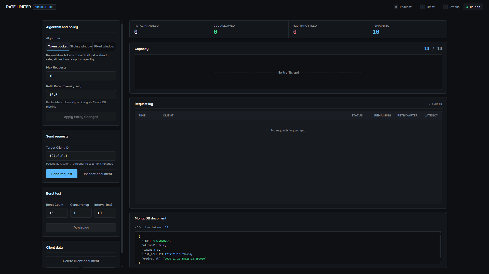

# Rate Limiter — MongoDB-Backed API Rate Limiting

> **Course:** Unstructured Database (CSE13202)
>
> A single-node API rate limiter built with **FastAPI** and **MongoDB** (Document Database), demonstrating three classic rate-limiting algorithms — each mapped onto MongoDB BSON documents, embedded arrays, atomic `findOneAndUpdate` aggregation pipelines, and TTL indexes.

---

## Table of Contents

1. [Architecture](#architecture)
2. [Why MongoDB (Document Data Model)?](#why-mongodb-document-data-model)
3. [Data Model — MongoDB Collections & Schemas](#data-model--mongodb-collections--schemas)
4. [Algorithm Explanations](#algorithm-explanations)
5. [API Reference](#api-reference)
6. [Project Structure](#project-structure)
7. [Setup & Installation](#setup--installation)
8. [Testing](#testing)
9. [Dashboard](#dashboard)
10. [Limitations](#limitations)
11. [Further Reading](#further-reading)

---

## Architecture

This service uses a single-node application architecture backed by a MongoDB document store:

```
┌────────┐       HTTP        ┌───────────────────────────────────┐
│        │ ───────────────►  │      FastAPI Server (Single Node) │
│ Client │                   │  ┌─────────────────────────────┐  │
│        │ ◄───────────────  │  │   Rate Limit Middleware     │  │
│        │   200 / 429       │  │  ┌───────────────────────┐  │  │  findOneAndUpdate   ┌─────────────┐
└────────┘                   │  │  │  Algorithm Layer      │  │  │  (Atomic Pipeline)  │             │
                             │  │  │  • Token Bucket       │──│──┼────────────────────►│   MongoDB   │
                             │  │  │  • Sliding Window Log │  │  │                     │   Server    │
                             │  │  │  • Fixed Window Ctr   │  │  │                     │             │
                             │  │  └───────────────────────┘  │  │                     │ Collections │
                             │  └─────────────────────────────┘  │                     │ + TTL Index │
                             │                                   │                     └─────────────┘
                             │  /            → hello endpoint    │
                             │  /limited     → rate-limited EP   │
                             │  /status/{id} → client document   │
                             │  /config      → view/update cfg   │
                             │  /dashboard   → live dashboard    │
                             └───────────────────────────────────┘
```

**Request lifecycle:**

1. Client sends an HTTP request.
2. FastAPI middleware intercepts every non-exempt request and identifies the client (`X-Client-ID` header, `X-Forwarded-For`, or client IP).
3. The middleware invokes the active rate-limiting algorithm.
4. The algorithm runs a single **atomic `find_one_and_update` aggregation pipeline** inside MongoDB (read → evaluate/refill/prune → write in one round-trip, avoiding race conditions).
5. If allowed → request proceeds with `X-RateLimit-Limit`, `X-RateLimit-Remaining`, and `X-RateLimit-Reset` headers.
6. If denied → `429 Too Many Requests` is returned immediately with a `Retry-After` header.

---

## Why MongoDB (Document Data Model)?

| Requirement | How MongoDB Solves It |
|---|---|
| **Flexible unstructured schema** | BSON documents store heterogeneous per-algorithm state (`tokens`, embedded `timestamps` arrays, window counters) with zero rigid table migrations |
| **Single-document atomicity** | `findOneAndUpdate` with aggregation pipelines (MongoDB 4.2+) performs conditional read-modify-write atomically without multi-document transactions or external locks |
| **Automatic expiration** | MongoDB **TTL indexes** (`expireAfterSeconds: 0` on `expires_at`) automatically purge inactive client buckets and closed windows |
| **Persistence & inspectability** | State survives server restarts and can be inspected directly via MongoDB Compass or `GET /status/{client_id}` |
| **Cloud or local ready** | Works identically on local `mongod` (`mongodb://127.0.0.1:27017`) or MongoDB Atlas (`mongodb+srv://...`) |

> For a deep dive into schema trade-offs, complexity, and atomic pipelines, see [`docs/DATA_MODEL.md`](docs/DATA_MODEL.md).

---

## Data Model — MongoDB Collections & Schemas

Each algorithm uses a dedicated MongoDB collection tailored to its access pattern:

### 1. Token Bucket → Collection `token_buckets`

```json
{
  "_id": "127.0.0.1",
  "tokens": 8.5,
  "last_refill": 1700000000.123,
  "allowed": true,
  "expires_at": "ISODate('2026-11-11T08:30:00Z')"
}
```

**Why this document model?** Token Bucket needs to read and update `tokens` and `last_refill` together atomically. Keeping both fields in one BSON document allows MongoDB's single-document lock and aggregation pipeline update to calculate elapsed refill and consume 1 token in one atomic operation.

---

### 2. Sliding Window Log → Collection `sliding_windows`

```json
{
  "_id": "127.0.0.1",
  "timestamps": [1700000001.10, 1700000002.42, 1700000003.85],
  "count": 3,
  "allowed": true,
  "expires_at": "ISODate('2026-11-11T08:30:00Z')"
}
```

**Why embedded arrays?** Instead of creating a separate document per request (which would require multi-document transactions to check + insert atomically), embedding `timestamps` inside one client document lets the pipeline prune old entries (`$filter`), check `$size`, and append (`$concatArrays`) atomically on standalone or replica-set MongoDB servers.

---

### 3. Fixed Window Counter → Collection `fixed_windows`

```json
{
  "_id": "127.0.0.1:28333333",
  "client_id": "127.0.0.1",
  "window_id": 28333333,
  "count": 4,
  "allowed": true,
  "expires_at": "ISODate('2026-11-11T08:25:00Z')"
}
```

**Why composite `_id` + TTL index?** Keying `_id` as `<client_id>:<window_id>` (where `window_id = floor(now / window_seconds)`) ensures O(1) `_id` index lookups and natural window rotation, while the TTL index on `expires_at` automatically deletes old window documents.

---

## Algorithm Explanations

### Token Bucket (Default)
1. Bucket starts full (`max_requests` tokens).
2. Tokens replenish smoothly at `refill_rate` tokens/sec, capped at `max_requests`.
3. Each request consumes 1 token if `tokens >= 1`; otherwise returns `429`.

### Sliding Window Log
1. Removes timestamps older than `now - window_seconds` from the embedded `timestamps` array.
2. If remaining count `< max_requests`, appends `now` and allows the request.
3. Otherwise rejects without adding to the log — preventing boundary spikes.

### Fixed Window Counter
1. Computes `window_id = floor(now / window_seconds)`.
2. Checks the counter for `<client_id>:<window_id>`.
3. If `count < max_requests`, increments atomically and allows; otherwise caps at `max_requests` and returns `429`.

---

## API Reference

| Method | Endpoint | Description |
|--------|----------|-------------|
| `GET` | `/` | Health-check endpoint returning database & active limiter configuration |
| `GET` | `/limited` | Explicitly rate-limited endpoint for testing (`X-Client-ID` optional) |
| `GET` | `/status/{client_id}` | Inspect the stored MongoDB rate-limit document for a client |
| `DELETE` | `/status/{client_id}` | Delete all rate-limit documents for a client |
| `GET` | `/config` | Return current configuration (algorithm, limits, MongoDB DB name) |
| `POST` | `/config` | Hot-swap algorithm or limits (`max_requests`, `window_seconds`, `refill_rate`) |
| `GET` | `/dashboard` | Interactive dark-theme live dashboard |
| `GET` | `/docs` | Swagger UI (OpenAPI docs) |

### Rate-Limit Response Headers

| Header | Description |
|--------|-------------|
| `X-RateLimit-Limit` | Maximum requests allowed / bucket capacity |
| `X-RateLimit-Remaining` | Remaining requests or whole tokens |
| `X-RateLimit-Reset` | UNIX timestamp when quota resets / next token refills |
| `Retry-After` | Seconds to wait before retrying (included on `429` responses) |

---

## Project Structure

```
rate limiter/
├── app.py                  # FastAPI application, middleware, routes, static mount
├── config.py               # Centralized configuration (MongoDB URI, limits, algorithm)
├── models.py               # MongoDB collections, TTL indexes, state inspection helpers
├── algorithms/
│   ├── __init__.py         # Package exports
│   ├── base.py             # Abstract base class: RateLimiter
│   ├── token_bucket.py     # Token Bucket — MongoDB document + atomic pipeline
│   ├── sliding_window.py   # Sliding Window Log — embedded array + atomic pipeline
│   └── fixed_window.py     # Fixed Window Counter — composite _id + TTL index
├── static/
│   ├── index.html          # Interactive dashboard UI
│   ├── style.css           # Dashboard styles (dark theme)
│   └── app.js              # Dashboard client logic
├── docs/
│   └── DATA_MODEL.md       # Deep dive: MongoDB document schemas & atomicity
├── test_limiter.py         # End-to-end MongoDB test suite for all 3 algorithms
├── requirements.txt        # Python dependencies (fastapi, uvicorn, pymongo, requests)
└── README.md               # This file
```

---

## Live Deployment Website
- The project is already hosted on (**https://nosql-rate-limiter.shounak25.me/dashboard**). You can try it out for free. However if you want to run it locally, here are the steps to do so:

## Setup & Installation

### Prerequisites

- **Python 3.10+**
- **MongoDB 4.2+** running locally (`127.0.0.1:27017`) or a **MongoDB Atlas** cluster

### 1. Configure MongoDB Connection (Optional)

By default the app connects to `mongodb://127.0.0.1:27017` and uses database `rate_limiter`. To override (e.g., for MongoDB Atlas):

```bash
# PowerShell
$env:MONGO_URI = "mongodb+srv://<user>:<password>@cluster.mongodb.net/"
$env:MONGO_DB = "rate_limiter"
```

### 2. Install Dependencies

```bash
pip install -r requirements.txt
```

### 3. Run the Server

```bash
uvicorn app:app --reload --host 127.0.0.1 --port 8000
```

Open **http://localhost:8000/dashboard** for the interactive UI or **http://localhost:8000/docs** for Swagger API docs.

---

## Testing

Run the automated test suite directly against MongoDB:

```bash
python test_limiter.py
```

This tests **Token Bucket**, **Sliding Window Log**, and **Fixed Window Counter** across three phases (**Allow → Block → Recover**), printing the live MongoDB documents stored during each test.

---

## Dashboard



Visit **http://localhost:8000/dashboard** to:
- Switch algorithms (`Token Bucket`, `Sliding Window Log`, `Fixed Window Counter`) at runtime
- Tune `Max Requests`, `Window Size`, and `Refill Rate`
- Test individual clients via `Client ID` (`X-Client-ID`)
- Run a configurable **Burst Test** with concurrency control
- Monitor real-time capacity and requests with the inline SVG time-series trace chart
- Inspect raw MongoDB BSON documents live with real-time field change highlighting

---

## Limitations

- **Client identity is header-trusted**: Client identification relies on the `X-Client-ID` header (falling back to `X-Forwarded-For` or client IP). In untrusted environments, clients can spoof their identity unless an upstream reverse proxy or API gateway sanitizes or strips these headers.
- **Configuration endpoints are unauthenticated**: The policy endpoints (`GET /config`, `POST /config`, and `DELETE /status/{client_id}`) are open and unauthenticated for local demonstration and assignment inspection purposes. In production, administrative routes will be protected behind authentication and authorization middleware.
- **Time source is the application server clock**: Time-based algorithms (`Token Bucket` refill and window boundaries) rely on the application server's system clock (`time.time()`). Clock drift across multi-instance deployments would lead to inconsistent rate evaluation; production multi-instance topologies will need to use NTP synchronization or a centralized database timestamp source.

---

## Further Reading

- [`docs/DATA_MODEL.md`](docs/DATA_MODEL.md) — Detailed MongoDB schema design, atomic pipelines, TTL index internals, and complexity analysis.
- [MongoDB Updates with Aggregation Pipeline](https://www.mongodb.com/docs/manual/tutorial/update-documents-with-aggregation-pipeline/)
- [MongoDB TTL Indexes](https://www.mongodb.com/docs/manual/core/index-ttl/)
